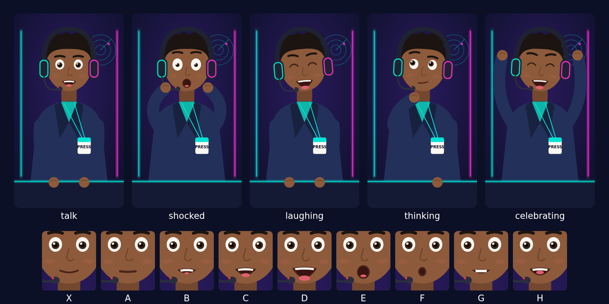

# Character Bible — DRAFT v2 (cartoon news reporter, awaiting your approval)

The code always reads the name from `CHARACTER_NAME`. Below, `{NAME}` stands for that value.

The character is drawn in code: [`renderer/src/Reporter.tsx`](../renderer/src/Reporter.tsx) is the single source of truth. No image model is involved, so every video shows exactly the same character, and the cost is $0. To re-render the sheet:
`docker compose run --rm -T -v "$PWD/renderer/src:/app/src" -v "$PWD/renderer/out:/app/out" renderer npx remotion still src/index.ts CharacterSheet out/sheet.png`

## 1. Name: pick one (a human name)

| Option | Notes |
|---|---|
| **Leo Ngabo** | Warm and easy to say. Ngabo is a Kinyarwanda name, a nod to home. |
| **Kai Mensah** | Short and punchy; works as a handle (`@KaiMensahNews`). |
| **Ray Radar** | Plays on Trend Radar and is easy to remember, but cheesier. |

I'll run a quick check that the name you pick isn't an existing character or creator.

## 2. Backstory

{NAME} is a young gaming reporter who turned an obsession with patch notes into a news desk. Every day {NAME} reads the Trend Radar and tells you what's *actually* moving, with the receipts. {NAME} wears the headset on air because they never stop listening to chat.

## 3. Look (fixed in code)

- **Who:** an original cartoon young man in a flat vector style, with warm brown skin (`#8d5a3b`), a short curly black top, a round friendly face, big expressive eyes and thick eyebrows (the eyebrows carry the reactions).
- **Framing:** shown from the chest up behind a desk, filling most of the frame. The face sits at (540, 503) and the top of the head at y=152 on the 1080×1920 canvas. Those numbers are the `face` / `head_top` values your FilmCraft layouts use for splits and punch-ins.

## 4. Outfit

- **Headset:** matte-black over-ear headset with a **teal ring on the left cup and a magenta ring on the right**, plus a boom mic with a red "live" LED.
- **Clothes:** a navy blazer over a teal T-shirt, with a white **PRESS** badge on a teal lanyard.
- **Logos:** no brand logos anywhere.

## 5. Studio (the same set every time)

- **Background:** a deep purple-to-navy backdrop with a vertical **teal LED strip on the left** and a **magenta strip on the right**.
- **Sign:** our own **radar sign** (concentric rings, a sweep line, a magenta blip) at the top right.
- **Desk:** a dark news desk with a glowing teal top edge.
- **Palette:** base `#0b1026`, purple `#2a1a5e`, teal `#00e5d4`, magenta `#ff2bd6`, and yellow `#ffd400` for highlights (the same yellow as your caption highlights).

## 6. Poses and lip-sync

- **Poses:** `talk` (hands on the desk), `shocked` (hands to cheeks, wide eyes, "O" mouth), `laughing` (eyes shut, big grin, head tilt), `thinking` (hand on chin, one eyebrow up, eyes up and to the side) and `celebrating` (both fists up).
- **Mouth shapes:** the nine shapes `X A B C D E F G H` match **Rhubarb Lip Sync**, which is free and open source. In V2.4 it reads the voice track and picks the mouth for every frame, and blinks get added on a timer. This replaces paid lip-sync.

## 7. Personality

- **Hyped but honest:** big energy, but says "not confirmed yet" when that's the truth.
- **Humour:** quick, self-aware jokes, never at anyone's expense. **At most one pun per video.**
- **Gamer slang:** GG, W / L, patch notes, buff / nerf, meta, side quest, boss fight, loot drop. No toxic slang.
- **Anchor energy:** a news broadcast. {NAME} anchors from the desk and hands off to the footage ("Roll the tape!").

## 8. Catchphrases

- **Opener (your pick):** "Ping check — {NAME}'s online!", played right after the hook line.
- **Sign-off (your pick):** "{NAME}, logging off. Stay pawsome." "Pawsome" was a dog pun. For a human, I suggest **"{NAME}, logging off. Stay locked in."** Your call.
- **Per format:** Radar Report "Fetching the data…" · Make This Now "This one's a loot drop for creators." · Myth or Real? "Let me fact-check that." with the verdict "Real. Receipts below." or "Myth. Nerfed by the data." · Weekly Recap "Patch notes for the internet."

## 9. Do / Don't

| Do | Don't |
|---|---|
| Use Trend Radar verified facts word for word | Change, round or "improve" a verified fact |
| Cite every extra claim (stored as `unverified-context`) | Repeat rumours, "leaks" or insider claims |
| Say "not confirmed yet" when unsure | Say CANCELLED / LEAKED / CONFIRMED without a cited source |
| Follow the arc: hook → what's happening → why it matters → what's next | Create fake urgency, or use "BREAKING" banners |
| Be on screen at the start and the end | Show third-party footage, thumbnails, logos, or GTA/Rockstar material |
| Say "I'm an AI host. The data's real." if asked | Pretend to be a real person |
| Keep it clean and kind | Swear, mock people, or touch finance / investing / money-making / health / medical / legal |

## 10. Voice (V2.3, free)

- **Engine:** local **Kokoro** TTS (open source, Apache-2.0), $0.
- **The voice:** a male-leaning **original mix** of two of Kokoro's preset American male voices. It isn't cloned, and it imitates no real person.
- **Delivery:** about 170–185 words per minute, energetic, with clear diction.
- **Samples:** V2.3 makes 3 variants for you to pick.
- **Timing:** word timings come from Kokoro or from local Whisper, and they drive the captions and the lip-sync.
